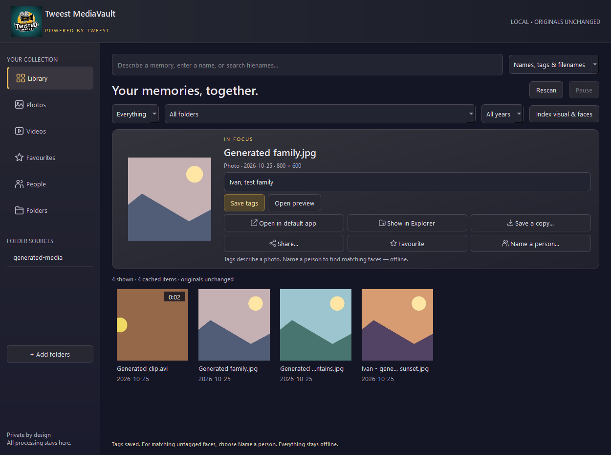

# Tweest MediaVault

**[Download for Windows](https://github.com/twistkan/tweest-mediavault/releases/download/v0.2.9/TweestMediaVaultSetup-0.2.9.exe)** · [Release notes and checksums](https://github.com/twistkan/tweest-mediavault/releases/tag/v0.2.9)

Native Windows Qt Widgets app, branded **Powered by Tweest**, using the supplied Twisted Imagez logo. All window backgrounds, dialogs and preview surfaces use a dark palette. There is no embedded website.

## Screenshot

Library view with generated sample media.

## Daily use

Open Tweest MediaVault from the packaged executable or installer-created shortcut. Add or drop a folder to index photos and video thumbnails. No source is scanned until you add it or press Rescan. Start with a representative sample rather than the entire archive.

- **Rescan** checks size and modification time and retains completed work. **Pause / Resume** controls the current scan or visual/face indexing job. After closing mid-job, Rescan or Index visual & faces skips completed items.
- The installed app's persistent SQLite catalog and thumbnails are kept under `%LOCALAPPDATA%\TweestMediaVault\data`, so the app works normally when installed in Program Files. A development run keeps data in this project's `data` directory. An existing beside-executable catalog is copied to the user profile on first launch if no profile catalog exists; the old copy is retained. Reopening reads the catalog before checking source drives. The grid paints visible thumbnails using a bounded in-memory cache; **Load more** loads another page of metadata.
- **Names, tags & filenames** searches original filenames, manually saved tags and confirmed person names. Any part of a saved person name also finds possible similar faces, visibly marked for review: Daphine or Aine both find Daphine Aine. Similar people mode supports the same partial names. A shared name returns matches for all named people containing it; people are not merged. Existing names in filenames are searchable immediately; they are not treated as proven face identities. Existing labels and face indexes need no rescan for this search update.
- Select a photo and save comma-separated tags. This never renames the photo or writes EXIF/IPTC metadata. For identifying a person, choose **Name a person…** in either preview. It prepares that photo's faces locally when needed, offers an existing single tag as a suggested name, and asks you to choose a face when several people are present. General photo tags and filename names are not silently assigned to faces.
- After a folder scan, local visual/face preparation starts automatically when bundled models are available. It can be paused. If you request a person name during indexing, that photo is queued next. Person searches use the completed face cache and remain available while indexing continues. **Index visual & faces** also resumes preparation for an existing catalog.
- **Similar people** combines exact text results with conservative local face-similarity matches from your named references. Matches remain suggestions, especially across decades, ages or poor lighting. **People** lists confirmed named people. Automatic unnamed-person clustering and a full group merge/split editor are not part of this first prototype.
- **Visual scenes** searches the local CLIP photo index using natural language. It does not examine scenes inside video clips or transcribe audio. The CPU backend is intentional for broad compatibility; GPU acceleration is not yet validated.
- Video tiles show a cached frame and duration when supported by the installed decoder. Open preview provides local video playback. HEIC/HEIF and some phone codecs may be unsupported; individual failures are retained visibly instead of blocking the library.
- The full video preview shows its cached thumbnail until you press Play, rather than an empty black player. Pausing retains the playing frame; stopping/end-of-playback returns to the thumbnail. Cached posters can still identify a clip on a disconnected drive, with playback disabled. If a thumbnail is unavailable, an explanatory placeholder is shown. Wheel up/down over either the poster or playing-video area navigates previous/next through mixed photo/video results; the timeline and volume controls keep their own input behavior. Zoomed photos still scroll vertically rather than navigating.
- Both previews provide **Open in default app** (opens the original in Windows Photos or your configured default app), **Show in Explorer** (selects the original), **Save a copy…** (exports the unchanged original, initially to Downloads), and **Share…**. Sharing offers a file on the clipboard for you to paste into your chosen app, or a copy of its path; nothing is uploaded or sent automatically. Saving a copy never replaces an existing file or the original.
- **Copy** in either preview puts the original file on the clipboard; supported photos also include orientation-correct image pixels for pasting into WhatsApp or another image-capable app. Videos and unsupported photo decoders provide the original file for apps that accept file pastes. Paste support depends on the receiving app. A status message confirms copying without an extra dialog; unavailable originals show an error and leave the clipboard unchanged. Copying does not export a new file or change the original.
- A cached thumbnail can remain after an original is moved or its drive disconnects. Preview opens the cached image with an availability notice. **Reconnect original…** on a missing entry lists available indexed copies with matching filename, type and size. Confirm only if it is the same media. Reconnection combines the missing entry with the chosen copy, preserves tags/favourites/face labels and cached analysis, and saves a SQLite catalog backup under `data/recovery-backups` first. Original files and cached thumbnails are not deleted. Conflicting confirmed face labels are retained for review. If no copy is listed, reconnect the drive or add/rescan the folder holding the moved file first. Copies are never automatically assumed identical from filename and size.
- **Edit a copy…** opens a spacious offline photo editor from either preview. It supports free/Original/Square/4:3/16:9 crop (plus portrait ratios), a drag crop rectangle and alignment grid, ±15° straighten with automatic edge trimming, 90° rotation and horizontal/vertical flips. Geometry changes reset the crop to prevent an old selection targeting the wrong area.
- Exposure, brightness, contrast, highlights and shadows have live local previews. Color controls add saturation (−100 for black-and-white) and vibrance, which favours muted colours over already strong colours. Undo/Redo and Reset are available; a slider drag is one undo step. Click the Before/After toggle to keep viewing either version; adjustment controls pause while Before is shown. Export always uses the edited recipe. Edits are temporary in this editor session; closing with unsaved changes offers a discard warning. Highlights/shadows controls cannot recover detail absent from the captured image.
- Save edited copy exports full-resolution JPEG (quality 60–100, default 92) or PNG. Both Save edited copy and Share edited copy open a Save dialog where you choose the folder and filename. The last successful export folder is remembered across editor/app restarts; the initial fallback is Downloads, not AppData. Share copies that chosen exported file to the clipboard for you to paste; cancelling creates no file. Previously created AppData/shared-edits copies are left untouched. Originals and existing destinations cannot be overwritten. EXIF orientation is applied once; exports omit camera/location metadata, and JPEG flattens transparency onto white. PNG preserves transparency. Nothing is uploaded automatically. Edited exports do not inherit face labels or automatically replace the catalog original. Offline models are not needed for editing.
- Save and Share automatically apply a valid visible pending crop, rather than quietly refusing to export. An unready or invalid selection gets a visible explanation. Export shows a busy indicator and a saved-file confirmation with Show saved copy to select the output in Explorer. Errors restore the controls and display the reason. Share-folder creation failures are also reported visibly.
- The editor and full preview include active Minimize/Maximize controls. Save dialogs have a Save location dropdown with Last location, Downloads, Documents, Desktop, Pictures, Videos and Home, alongside the normal folder browser. Selecting a location preserves the filename; unavailable common folders are disabled. Common destinations are also available in the sidebar. The last successful export folder is still remembered.
- The enlarged, resizable full preview has Previous / Next and a position counter. Navigation follows the filtered browsing order; normal browsing and filename/tag results include matches beyond the first 500 loaded tiles. Person/visual searches use the current ranked result list. Moving away from a video stops playback and releases its source. The path, favourites and other actions always target the displayed item.
- Photos support double-click to toggle zoom/Fit, zoom icons, 100% decoded-pixel view, Fit and dragging to pan. In Fit view, Left/Right arrows and the mouse wheel move to previous/next media (wheel up = previous, down = next). While manually zoomed, the wheel scrolls vertically and arrow keys pan the image; they do not change media. Click Fit or double-click to restore navigation. Video previews retain the timeline/volume controls and hide photo zoom buttons; Left/Right navigate unless the timeline or volume slider has focus, where arrows retain their slider function. Moving to another photo resets to Fit. Unavailable originals display a clear message and cached thumbnail where possible, while navigation remains usable. Extremely large images are decoded with an 8192-pixel longest-edge limit to bound preview memory; 100% refers to that decoded image.
- Setup is a single `.exe` containing the app and offline models. No separate checksum file is needed when copying or installing it.
- Video timelines support clicking to jump and dragging to seek on release, while preserving play/pause state. With the timeline focused, arrow keys move by one second and Page Up/Down by five seconds. Seeking is enabled for media the player reports as seekable.
- Video previews include a volume slider and percentage. Click the speaker icon to mute/unmute while retaining the selected level; adjusting above zero also unmutes. These controls affect MediaVault playback, not Windows master volume.
- Choose a year and then a month beside it to narrow browsing, names/tags, favourites, people and visual searches. All months restores the whole selected year; choosing a month with All years searches that month across years. Recognised archive folder years (including Phone Pix 2026 and 01 January 2026) and months take priority over media dates for these filters. If a folder year/month is not recognised, that part falls back to the catalog date. Original media dates remain unchanged. Selections survive restarting; existing cached paths are upgraded without face rescanning.
- Missing a newly added subfolder? Use Add folders and select that subfolder again. If its parent is already registered, MediaVault checks only the selected subtree using the parent's catalog ownership, without creating duplicate sources or rebuilding unchanged faces. Adding folders resets old search/date/type filters. Show all media also clears filters manually. The count shows loaded versus matching items; Load next 500 reveals more while preserving your browsing position. Rescan still checks all registered sources.
- Add folders supports Ctrl+click for separate folders and Shift+click for a contiguous range. Click Add selected folders to submit the selection as one batch. The picker lists directories only. Its Folder path bar accepts pasted Windows paths (including quoted paths), environment-variable paths, UNC paths and local file:// folder links; press Enter or Go to navigate without importing. Web links and unavailable paths show an explanation. Navigating clears the old selection. With no folders selected, Add imports the current directory, so you can paste a library folder and add it directly. Cancel imports nothing; duplicate detection/logging still applies to the selected batch.
- After the installed window opens, a background filename/size/timestamp check looks for supported media missing from the cache or changed since indexing. A popup offers a targeted rescan; declining leaves a Rescan missing media banner. Folders → Check for missing media repeats the check. Disconnected/inaccessible drives are reported separately and keep their cache. The check does not decode images or scan faces; a rescan starts only when requested. If AI is busy, it stops at a safe checkpoint before the requested rescan.
- Re-adding fully indexed, unchanged folders is skipped. New or changed media is accepted. Copies of registered or previously scanned folders with identical relative media paths and sizes are verified with SHA-256 of every media file before being skipped; these checks run in the background. Similar names alone never trigger a skip. No originals are deleted. Copied-folder checks cover supported media, not accompanying documents. Folders → Open library log shows local duplicate decisions, queued/rejected folders and rescan checks. The file is `%LOCALAPPDATA%\TweestMediaVault\data\library-log.jsonl` in installed builds.
- The star/favourite button saves locally and a **Favourites** sidebar tab browses starred photos/videos, with folder/date/search filters. Stars survive rescans, restarts and disconnected drives. Cached favourites can be browsed offline; opening, exporting and sharing require the original drive to be connected.
- Disconnected sources retain cached thumbnails and labels. Original previews require the drive to be available. Missing files are not automatically purged by a rescan.
- In **Folders**, remove an individual folder or **Clear library**. These actions only unregister sources and delete this app's derived cache. Originals remain untouched. You can keep tags, favourites and named-face references for re-adding the same paths, or explicitly forget them.

## Installation

Setup defaults to `%LOCALAPPDATA%\Programs\TweestMediaVault`, which does not normally need administrator rights. Choosing a parent such as `C:\Program Files (x86)` installs into its own `TweestMediaVault` subfolder and requests Windows administrator approval before extraction. If approval is cancelled, setup remains available so you can choose a user folder instead. Setup preserves the original user's chosen desktop shortcut path when it relaunches elevated. After elevated installation, close setup and open the app normally using the shortcut; setup does not launch the app with administrator rights.

Library, Photos, Videos, Favourites, People and Folders have matching native vector icons; the selected item uses the brand's gold accent. Preview actions also have icons.

## Developer setup

Use Python 3.12 in the project-local `.venv312`. Install `requirements.txt`. Run `setup_models.py` once to download model assets, then `desktop_app.py`. Runtime indexing and searching never download anything or send media to a service. Model downloads and package setup require network access.

The first prototype uses Qt for Python ([documentation](https://doc.qt.io/qtforpython-6/)), SQLite, Pillow, OpenCV YuNet/SFace ([model source and licenses](https://github.com/opencv/opencv_zoo)), and [quantized CLIP ONNX exports](https://huggingface.co/Xenova/clip-vit-base-patch32). Model files, licenses, source URLs and SHA-256 hashes are recorded under `models`. The installer packages the local models; personal catalogs and photos are excluded.

Run `test_vault.py` for generated-media data safety checks. Run `desktop_app.py --smoke` for a native-window startup screenshot. These commands do not scan the user's archive. Prototype accuracy, full-library throughput, and portability to a clean second PC require separate validation.

